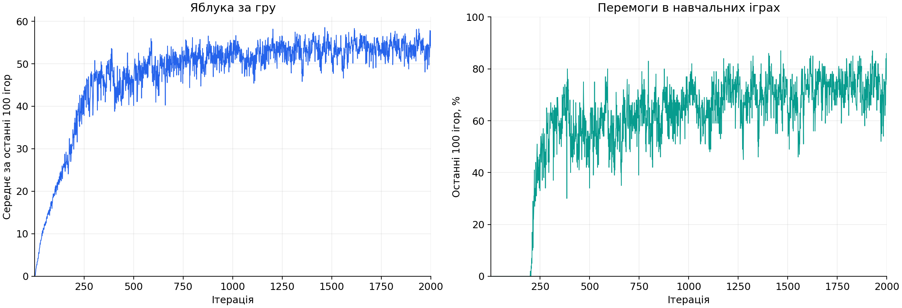

<p align="center">
  
  
  
</p>

# SnakeAI v9

SnakeAI v9 навчається методом PPO. Згорткова мережа бачить поле через 13 каналів, Actor обирає один із трьох ходів, а Critic оцінює майбутню винагороду. Небезпечні ходи залишаються доступними: програма не підміняє рішення мережі перевіркою зіткнень.

Останнє навчання почали з випадкових ваг і довели до **2000 ітерацій**. Фінальна модель виграла **178 із 200 нових тестових ігор (89%)**. У репозиторії є дві готові моделі, повна історія цього навчання та код для відтворення перевірки.

## Швидкий запуск

Потрібен Python 3.11. У корені репозиторію створіть середовище та встановіть пакет:

```powershell
py -3.11 -m venv .venv
.\.venv\Scripts\Activate.ps1
python -m pip install -e .
snake-play
```

На Linux/macOS середовище створюється командою `python3.11 -m venv .venv` та активується через `source .venv/bin/activate`. Для графічного вікна потрібен Tkinter. Гра й оцінювання працюють на CPU. Навчання потребує CUDA-сумісної збірки PyTorch.

`snake-play` використовує модель 2000, доки немає нового локального навчання. Закриття вікна завершує показ. Для іншої моделі:

```powershell
snake-play --checkpoint models/iteration_000950
snake-play --checkpoint models/iteration_002000
```

## Результати

| Модель | Перемоги | Середнє яблук із 61 | Середня винагорода |
|---|---:|---:|---:|
| Ітерація 950 | 154 / 200, **77%** | 55,365 | 55,665 |
| Ітерація 2000 | 178 / 200, **89%** | 58,260 | 59,308 |

Обидві моделі зіграли на однакових 200 нових початкових умовах, `seed 700000–700199`. Ваги під час тесту не змінювалися. Мережа обирала найімовірнішу дію. 89% є оцінкою на цьому наборі, з приблизним 95% інтервалом 83,9–92,6%.



Лінії показують останні 100 завершених навчальних ігор на кожній із 2000 ітерацій. Під час навчання дії вибираються випадково з імовірностей мережі. Тому ці графіки й окремий тест описують різні режими гри та різні набори партій.

```powershell
snake-evaluate --checkpoint models/iteration_000950 --episodes 200 --seed 700000
snake-evaluate --checkpoint models/iteration_002000 --episodes 200 --seed 700000
```

У фінальному тесті було 20 зіткнень із тілом і 2 зі стіною. У 9 поразках перед останнім ходом існував варіант без негайної поразки. У 13 усі три дії вже були програшними, тому помилку треба шукати раніше. Докладні дані містяться в [результатах](results/README.md).

## Будова мережі

Actor і Critic мають окремі ваги й однакову згорткову частину:

| Частина | Розмір / налаштування | Активація |
|---|---|---|
| Вхід | 10 × 10 × 13 | — |
| Згортка 1 | 13 вхідних каналів, 32 вихідних | ReLU |
| Згортка 2 | 32 вхідних канали, 64 вихідних | ReLU |
| Згортка 3 | 64 вхідних канали, 64 вихідних | ReLU |
| Кожна згортка | Вікно 3 × 3, stride 1, padding 1 | — |
| Flatten | 64 × 10 × 10 = 6400 чисел | — |
| Повнозв'язні шари | 6400 входів, потім 256 і 128 нейронів | ReLU після кожного прихованого шару |
| Вихід Actor | 3 оцінки: прямо, ліворуч, праворуч | Softmax у розподілі дій |
| Вихід Critic | 1 оцінка майбутньої винагороди | Лінійний вихід |

[Докладна архітектура](docs/architecture.md) · [Навчання](docs/training.md) · [Готові моделі](models/README.md)

## Нове навчання з живими графіками

У Windows один скрипт запускає окремий процес навчання та вікно з графіками й безперервною грою:

```powershell
.\scripts\start-live.ps1 -RunName experiment_01 -Iterations 2000
```

Можна запускати окремо в різних терміналах:

```powershell
snake-train --run-name experiment_01 --settings-from configs/training.json --iterations 2000
snake-dashboard --run-dir runs/experiment_01
```

За замовчуванням нове навчання починається з випадкових ваг. Показова гра підхоплює найновіші готові ваги лише перед початком наступної партії. Навчання продовжується незалежно від вікна. Щоб зупинитися зі збереженням після поточної ітерації, натисніть кнопку у вікні або запустіть `.\scripts\control.ps1 stop`.

## Організація репозиторію

```text
src/snake_v9/       середовище, мережа, PPO, статистика й завантаження моделей
src/snake_v9/cli/   команди гри, навчання, оцінювання та вікна графіків
configs/           відтворювані налаштування навчання
models/            тільки моделі 950 та 2000
results/latest/    очищена історія й результати останнього навчання
docs/              пояснення та графіки
scripts/           зручні команди PowerShell
tools/             побудова графіків і перевірка публічних файлів
tests/             перевірки правил, архітектури й збереження
legacy/v8/         початкова реалізація
```
